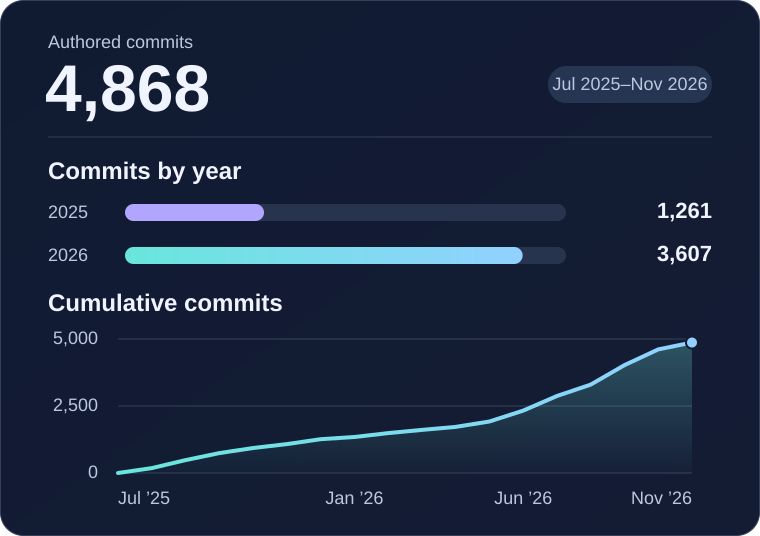

<h1 align="center">Mohamed Hedi Abdessalem</h1>

<strong>Full-stack software engineer</strong> 
Mobile engineering · Payments · Trust &amp; safety · Cloud tooling

  <a href="#contribution-history">Contribution history</a> &nbsp;·&nbsp;
  <a href="#what-ive-built">What I’ve built</a> &nbsp;·&nbsp;
  <a href="#toolkit">Toolkit</a>

---

I build features from the mobile interface through the API and database. My work includes Stripe payment flows, AI-assisted moderation, real-time messaging, event ticketing, and visual tools for cloud architecture.

## Contribution history

Each distinct commit I authored counts once, including commits on non-default branches. The total excludes merge commits and reflects the four codebases reviewed through November 18, 2026.

## What I’ve built

### Payments, e-wallets & billing

- Integrated Stripe PaymentSheet, webhooks, and Stripe Connect for payment confirmation, tips, transfers, organizer payouts, and refunds.
- Built e-wallet workflows for balances, transaction history, linked bank accounts, IBAN/BIC details, verification documents, and held event funds. Connected mobile payment screens to backend billing and account status.
- Implemented subscription tiers, usage limits, renewal discounts and plan changes, cancellation flows, and referral rewards. Worked on billing profiles, tax and commission data, and PDF and CSV records for subscriptions, tips, events, and referrals.

### AI moderation, verification & privacy

- Built NSFW detection and moderation workflows for avatars, banners, galleries, posts, and chat uploads. Adapted an NSFWJS classifier with TensorFlow.js and Sharp, integrated Claude for text and media checks, and worked with Amazon Rekognition, Google Cloud Vision, and Sightengine for image and face validation.
- Implemented selfie and face checks, duplicate-face detection, blocked-media feedback, and safeguards for unsafe links, spam, and restricted contact details. Connected moderation outcomes to mobile upload and editing flows.
- Built account onboarding and recovery, Infobip SMS verification flows, JWT session refresh, private gallery permissions, and Android screenshot protection. Connected the Laravel admin dashboard to the API and mobile app for real-time terms updates, versioned consent, and acceptance records.

### Real-time messaging & social features

- Built direct and group messaging with GraphQL subscriptions, presence, typing indicators, read receipts, and Firebase Cloud Messaging push notifications. Made offline retries idempotent and improved inbox and media loading with batched MongoDB reads and indexed cursor pagination.
- Built chat media capture, voice playback, link previews, and attachment sharing. Tracked upload progress across the app and API and normalized mobile recordings to seekable MP4 with FFmpeg.
- Developed personal and professional profiles, public and private galleries, and social feeds with posts, comments, reactions, polls, sharing, and classifieds. Implemented visibility rules and relationship-aware access across feeds and conversations.

### Events, discovery & mobile delivery

- Built event discovery, invitations, ticketing and QR check-in, participant management, cancellation and refund flows, and post-event testimonials. Implemented organizer and moderator permissions and configurable release of private venue details.
- Developed proximity-ranked search, saved filters, and location autocomplete for profiles, professional listings, and events. Worked on opt-in native location scheduling, permissions, and deep links.
- Maintained React Native features for Android and iOS, contributed native Kotlin and Objective-C code, and wired GitHub Actions and Gradle to build APKs and publish artifacts through a Laravel release API.

### Cloud storage, architecture & developer tooling

- Built Amazon S3 storage flows for profile photos, galleries, post media, and chat attachments. Implemented background processing, thumbnail generation, and upload rollback, and added validation for CloudFront-hosted media.
- Built an interactive architecture canvas with a searchable multi-cloud resource catalog, project-scoped designs, and an AWS SAM YAML preview. Added sample infrastructure inventory, alert history, and guided DevOps troubleshooting scenarios.
- Built a NestJS and PostgreSQL workspace with organization roles, project and environment records, persisted designs, and same-origin sign-in. Prototyped server registration, TCP reachability checks, and read-only Linux inspection over SSH with encrypted credentials and host-key verification.
- Added unit, integration, API, load, and browser tests. Automated build and verification steps with GitHub Actions, including dependency audit checks.

## Toolkit

### Mobile

React Navigation · Jotai · Objective-C · Gradle · i18next

### Web & UI

Zustand · React Flow · Monaco Editor

### Backend & data

JavaScript · Node.js · PHP · Laravel · REST · Apollo · WebSockets · MongoDB · Mongoose · Drizzle ORM

### AWS & cloud services

AWS SDK · AWS SAM · Amazon Rekognition · Firebase Cloud Messaging · Google Places

### Payments & integrations

Stripe PaymentSheet · Infobip

### AI & computer vision

Sightengine · NSFWJS

### Delivery & testing

Docker Compose · Linux · SSH · Playwright · Postman/Newman · Artillery
